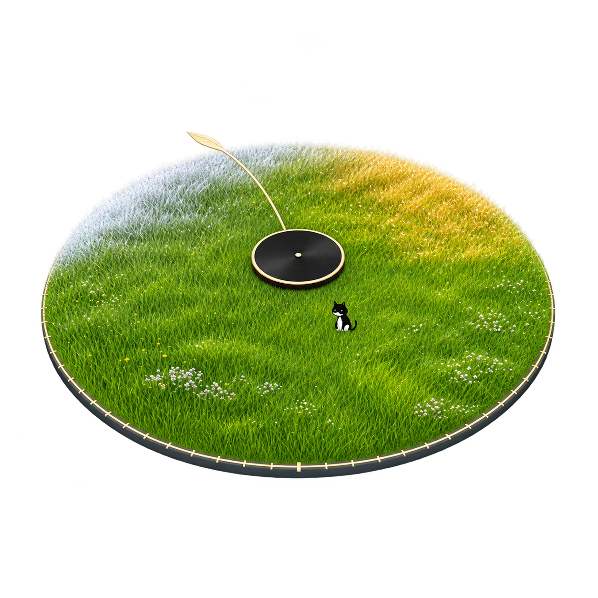
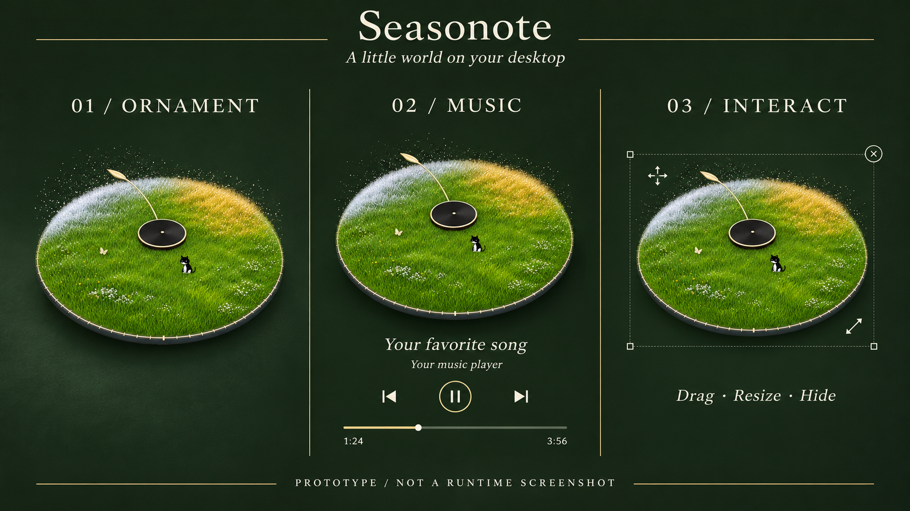
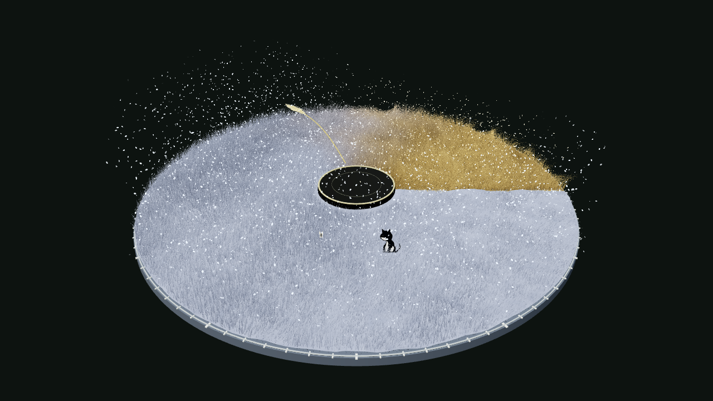
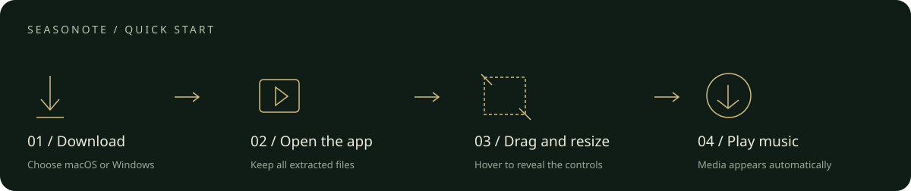

<p align="center">
  
</p>
<h1 align="center">Seasonote</h1>
<p align="center"><b>把四季放在桌面上，让音乐自然出现。</b><br/>A little world on your desktop.</p>
<p align="center">macOS · Windows · WebGL · 2D Cat · System Media</p>
<p align="center">
  <a href="https://github.com/haidarkhanuk3344-collab/Seasonote/releases/tag/v0.4.0">下载应用</a> ·
  <a href="docs/USAGE.md">操作指南</a> ·
  <a href="docs/BUILD.md">开发与构建</a> ·
  <a href="docs/STATUS.md">验证进度</a> ·
  <a href="LICENSE">MIT License</a>
</p>



> 上图是 AI 辅助制作的**原型示意图**，展示纯摆件、音乐和操作状态；不是运行截图。下方为真实渲染效果。

## 一只猫，一只蝴蝶，一整个四季

Seasonote 是一款本地运行的桌面动态摆件。斜俯视的草地转盘上，风吹过细草、草尖闪光、雨雪落下，四季连续流转。一只二维奶牛猫与蝴蝶留在这个小世界里，可以点击互动。

没有音乐时，它安静地待在桌面。播放器开始发布歌曲信息后，歌名、封面和播放控制自然出现；暂停仍保留，播放器退出后又回到纯摆件。



*真实场景渲染，冬季过渡状态；当前草地、猫、粒子效果仍在持续迭代。*

## 下载与打开

| 系统 | 下载 | 第一次使用 |
|---|---|---|
| Windows · Intel / AMD | [Windows x64](https://github.com/haidarkhanuk3344-collab/Seasonote/releases/download/v0.4.0/Seasonote-Windows-x64.zip) | **完整解压 → 双击 Seasonote.exe** |
| Windows · ARM | [Windows ARM64](https://github.com/haidarkhanuk3344-collab/Seasonote/releases/download/v0.4.0/Seasonote-Windows-arm64.zip) | **完整解压 → 双击 Seasonote.exe** |
| macOS · Apple Silicon / Intel | [Mac Universal](https://github.com/haidarkhanuk3344-collab/Seasonote/releases/download/v0.4.0/Seasonote-Mac.zip) | 把 Seasonote.app 拖进「应用程序」后打开 |

这是解压即用的应用包。Windows 包中的 DLL 是随附运行文件，入口为 **Seasonote.exe**；保留整个文件夹。首次运行会创建桌面快捷方式，以后双击桌面上的 Seasonote 即可。包内有中文说明书。

系统要求：macOS 13+；Windows 10 2004+ / Windows 11。Windows 包包含 .NET 运行库，缺少 WebView2 时会提供微软官方安装引导。Mac 当前为本地签名、未经 Apple 公证；安装细节与源码构建见指南。

**当前为 0.4.0 开源预览版。Mac 已做真实 QQ 音乐和桌面操作验证；Windows 已完成双架构编译与程序测试，仍待真实设备确认透明桌面、Win+D、DPI 和 QQ 音乐控制。** [查看验证进度](docs/STATUS.md)

## 在桌面上做这些事



| 操作 | 方法 |
|---|---|
| 移动 / 缩放 | 直接拖动；鼠标移入后拖四角，位置与大小会记住 |
| 互动 / 调整季节 | 点击猫或蝴蝶；按住 Shift 拖动指针 |
| 收起 / 重新显示 | 右上角 × 收起；双击桌面入口恢复 |
| 设置 / 退出 | Mac 菜单栏或 Windows 托盘菜单，支持大小、速度、天气、画质与退出 |
| 音乐控制 | 上一首、播放/暂停、下一首、进度拖动，按播放器能力启用 |
| 浏览器预览 | 四季进度、衬底、沉浸模式、透明 PNG 导出 |

摆件位于桌面层，其他应用会遮住它。隐藏或退出摆件不停止音乐。季节暂停时，猫、草与天气仍继续运动。没有开机自启动，不要求音乐账号。

音乐连接使用系统媒体信息，QQ 音乐等播放器需要先开始播放并发布有效曲目；仅安装播放器不会自动播放歌曲，也不是所有播放器版本都保证兼容。

## 从源码开始

浏览器预览无需 npm 安装：

```sh
python3 -m http.server 8080 --bind 127.0.0.1 --directory seasons
```

打开 `http://127.0.0.1:8080`。原生音乐控制需要运行桌面外壳。

```text
seasons/                    共享渲染器、二维角色、天气、音乐 UI
  macos/                    Swift + WKWebView 桌面外壳
  windows/                  C# + WPF / WebView2 桌面外壳
music-connection/            macOS 媒体桥与带许可的上游适配器
scripts/                    Windows 构建入口
tests/                      共享 UI、媒体、资源服务与尺寸运算测试
docs/                       使用、构建、验证与设计素材
```

[构建桌面应用与运行测试 →](docs/BUILD.md)

## 贡献与许可

欢迎提交 [Issue](https://github.com/haidarkhanuk3344-collab/Seasonote/issues/new/choose) 和 PR，特别是 Windows 真实设备反馈。请说明系统/播放器版本、复现步骤以及实际测试结果。详见 [贡献指南](CONTRIBUTING.md)。

原创项目代码采用 [MIT](LICENSE)；Three.js、MediaRemote adapter、WebView2 与 .NET 保留各自许可，见 [第三方声明](THIRD_PARTY_NOTICES.md)。项目包含 AI 辅助开发与设计素材。仓库不包含用户桌面截图、个人诊断、音乐文件或参考原片。
