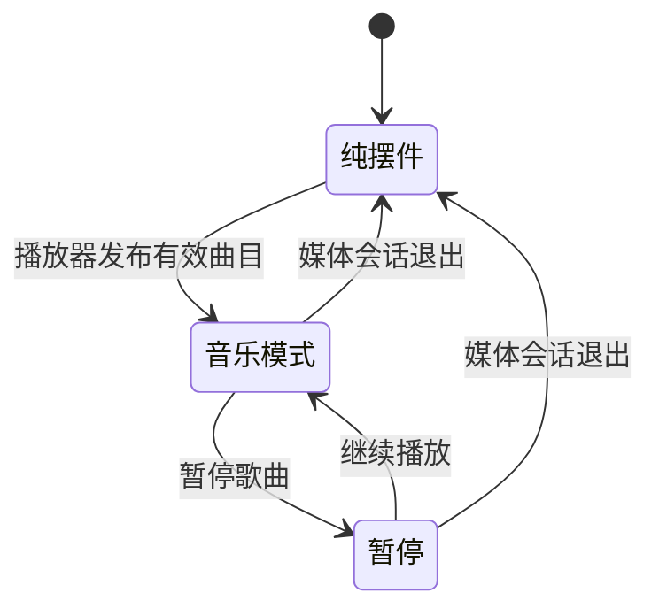

# 操作指南

## 下载与第一次打开

从仓库 [Releases](https://github.com/haidarkhanuk3344-collab/Seasonote/releases/tag/v0.4.0) 下载对应平台的压缩包，不要把 GitHub 的「Source code」当成已经构建的应用。

| 电脑 | 下载文件 | 打开方式 |
|---|---|---|
| 常见 Intel / AMD Windows | Seasonote-Windows-x64.zip | 完整解压，双击 **Seasonote.exe** |
| ARM Windows（例如骁龙） | Seasonote-Windows-arm64.zip | 完整解压，双击 **Seasonote.exe** |
| Apple Silicon / Intel Mac | Seasonote-Mac.zip | 解压，把 Seasonote.app 拖进「应用程序」后打开 |

Windows 文件夹里会有大量 DLL，这些是程序随附的运行文件。入口是 **Seasonote.exe**（开启隐藏扩展名时显示为 Seasonote，类型为「应用程序」）。不要只移动 exe，保留整个解压文件夹。首次启动会创建桌面快捷方式。Mac 首次运行也会创建桌面别名。

Windows 需要 WebView2 显示组件，缺失时程序会提供微软官方安装页面，安装后重新打开。Mac 应用使用本地签名，尚未做 Apple 公证；若系统不允许启动，可自行从源码构建，不需要关闭系统安全保护。

## 日常操作

| 想做什么 | 怎么操作 |
|---|---|
| 移动 | 按住摆件拖动 |
| 缩放 | 鼠标移入，拖动四角 |
| 让猫或蝴蝶互动 | 点击猫或蝴蝶 |
| 手动调整四季 | 按住 Shift 拖动盘面或金色指针 |
| 收起摆件 | 移入后点击右上角 × |
| 重新显示 | 双击桌面 Seasonote；Mac 也可点 Dock，Windows 可点托盘图标 |
| 彻底退出 | Mac 菜单栏 / Windows 托盘菜单 → 退出 Seasonote |
| 补建桌面入口 | 同一菜单 → 创建桌面快捷方式 |
| 更换画质、天气、速度 | 同一菜单里选择；也可打开浏览器预览 |

Windows 托盘图标可能在任务栏右侧的「^」展开区。关闭开关窗口不会退出摆件。位置和大小会保存，季节/天气/画质等设置重启恢复默认。摆件固定在桌面层，应用窗口会遮住它。

## 音乐模式

没有音乐时不出现空的音乐控件。QQ 音乐开始播放并发布系统媒体信息后，会自动显示封面、歌名和进度。暂停歌曲仍保留控制；退出播放器后恢复纯摆件。其他系统媒体来源也可能成为当前播放器。仅安装 QQ 不会自动开始播放；Seasonote 不要求填写 QQ 账号。

支持上一首、播放/暂停、下一首及拖动进度，具体可用操作取决于播放器公布的能力。隐藏或退出 Seasonote 不会暂停音乐。季节暂停只停止四季进度，草地、猫和天气仍会运动。

## 遇到问题

- 解压后只看到 DLL：搜索 `Seasonote.exe`，运行类型为「应用程序」的那个文件。
- 没看到摆件：先显示桌面，再从桌面入口或系统菜单选择显示；检查是否曾经收起。
- 没连到 QQ：先在 QQ 播放一首歌；它必须向系统提供媒体会话信息，并非所有播放器版本都保证支持。
- Windows 异常：运行包里的「导出诊断.cmd」，检查报告后再自行决定是否附到 Issue。报告可能包含电脑配置与本地错误路径，不要上传账号、令牌、个人文件或音乐凭据。

请在 [Issue](https://github.com/haidarkhanuk3344-collab/Seasonote/issues/new/choose) 中写明系统版本、架构、播放器版本、复现步骤和实际现象。
